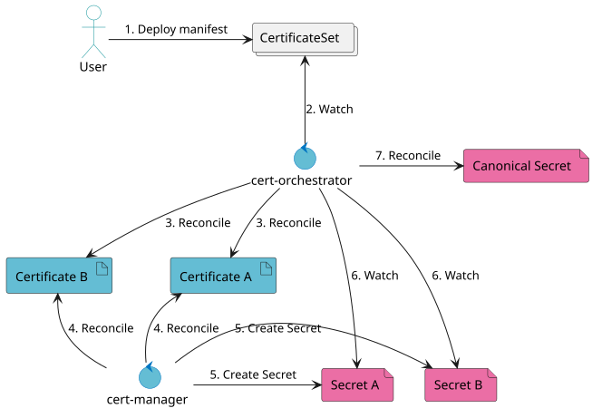

# cert-orchestrator

Automatic TLS certificate failover for Kubernetes.


## Description

`cert-orchestrator` is a Kubernetes controller inspired by [Cloudflare's backup certificate architecture](https://blog.cloudflare.com/introducing-backup-certificates/). It aims to improve TLS resilience by maintaining certificates issued by independent Certificate Authorities (CAs) and automatically selecting an acceptable certificate when the primary is no longer suitable.

## Motivation

Automated certificate renewal does not eliminate CA-related risks. A CA may suffer a security incident, mis-issue certificates, have its trust revoked, or become unable to issue replacements when they are urgently needed. Recent examples include [eMudhra's compromised intermediate CA private keys](https://bugzilla.mozilla.org/show_bug.cgi?id=2083449), [GoDaddy's mass revocation of mis-issued certificates](https://bugzilla.mozilla.org/show_bug.cgi?id=2082703), and [GoDaddy issuing certificates using a previously compromised private key](https://bugzilla.mozilla.org/show_bug.cgi?id=2079943).

Even with automated renewal, an affected certificate may need to be replaced long before its expiration date.

Maintaining a certificate from an independent CA provides an alternative that is already available when the primary certificate can no longer be trusted. This reduces dependence on emergency re-issuance and deployment during an incident.

Cloudflare employs a similar principle with backup certificates. However, Cloudflare controls its TLS termination infrastructure and can manage certificate selection centrally. Kubernetes environments are more heterogeneous: ingress controllers, proxies, and individual workloads consume certificates through different mechanisms, and some require restarts or explicit reloads to apply changes.

`cert-orchestrator` adapts this principle to Kubernetes by exposing the selected certificate through a conventional TLS Secret. Workloads can continue consuming certificates as they would consume a `cert-manager`-managed Secret, without implementing their own CA failover logic.

### Why not just use ARI?

[ACME Renewal Information (ARI), RFC 9773](https://www.rfc-editor.org/rfc/rfc9773.html), improves certificate lifecycle management by allowing CAs to recommend renewal timing, including in response to incidents that require early replacement.

However, ARI coordinates renewal; it does not ensure that a certificate from an independent CA is already available. Emergency replacement still depends on obtaining a new certificate and propagating it to every consumer. ARI can help facilitate this process, but it does not eliminate those dependencies. It can also not be relied upon when there is an incident requiring the entire CA to be distrusted.

`cert-orchestrator` addresses a complementary problem: keeping independently issued certificates available in advance and selecting an acceptable alternative when necessary. ARI remains useful for renewing both certificates appropriately; `cert-orchestrator` provides the selection and distribution layer.

## How it works



Multiple certificates are issued and renewed independently, typically using `cert-manager`, with each certificate stored in its own Secret.

`cert-orchestrator` watches these Secrets, validates the available certificates, and selects one according to a configurable policy. It then reconciles a destination TLS Secret containing the selected certificate chain and its corresponding private key.

Consumers continue referencing this destination Secret as a standard Kubernetes TLS Secret. This supports integrations such as Contour/Envoy and other workloads that consume Kubernetes TLS Secrets, without requiring them to understand individual CAs or implement certificate selection themselves.

The destination Secret contains one selected certificate at a time; it is not a concatenation of alternative certificates. Consumers must still observe Secret updates and reload their TLS configuration as required.

## Goals

- CA redundancy: Reduce dependence on any single CA by maintaining independently issued certificates

- Automatic failover: Select an acceptable alternative when the preferred certificate becomes unsuitable

- Transparent consumption: Preserve compatibility with conventional Kubernetes TLS Secret consumers

- Separation of concerns: Leave issuance and renewal to `cert-manager` while centralizing certificate selection

- Safe selection: Provide several selection algorithms to suit different use cases and risk tolerances

`cert-orchestrator` does not replace cert-manager or ARI, guarantee instantaneous propagation to every workload, or eliminate the need for appropriate incident-response policies. Its purpose is to make cross-CA certificate redundancy practical in heterogeneous Kubernetes environments.

## Installation

It is recommended to have `cert-manager` installed first, optionally in a different namespaces for better security. 

The easiest way to install `cert-manager` is via Helm:

```sh
helm install \
  cert-manager jetstack/cert-manager \
  --namespace cert-manager \
  --create-namespace \
  --set crds.enabled=true
```

`cert-orchestrator` can be installed via Helm:

```sh
helm install --create-namespace --namespace cert-orchestrator cert-orchestrator oci://ghcr.io/hsn723/charts/cert-orchestrator --version ${VERSION}
```

## Usage

Create a `CertificateSet` resource defining a set of `Certificates` and their primary/fallback `Issuers`.

```yaml
apiVersion: cert-orchestrator.atelierhsn.com/v1
kind: CertificateSet
metadata:
  name: certificateset-sample
spec:
  template:
    spec:
      dnsNames: ["example.com"]
  issuers:
    primary:
      kind: Issuer
      name: letsencrypt
    fallbacks:
      - kind: Issuer
        name: zerossl
  selectionAlgorithm: Strict
  evaluationInterval: 1m
```

This will template two `Certificate` resources for `cert-manager` to reconcile, after which their respective `Secrets` will be evaluated to select the presentation certificate.

## License

Copyright 2026 Hsn723.

Licensed under the Apache License, Version 2.0 (the "License");
you may not use this file except in compliance with the License.
You may obtain a copy of the License at

    http://www.apache.org/licenses/LICENSE-2.0

Unless required by applicable law or agreed to in writing, software
distributed under the License is distributed on an "AS IS" BASIS,
WITHOUT WARRANTIES OR CONDITIONS OF ANY KIND, either express or implied.
See the License for the specific language governing permissions and
limitations under the License.
